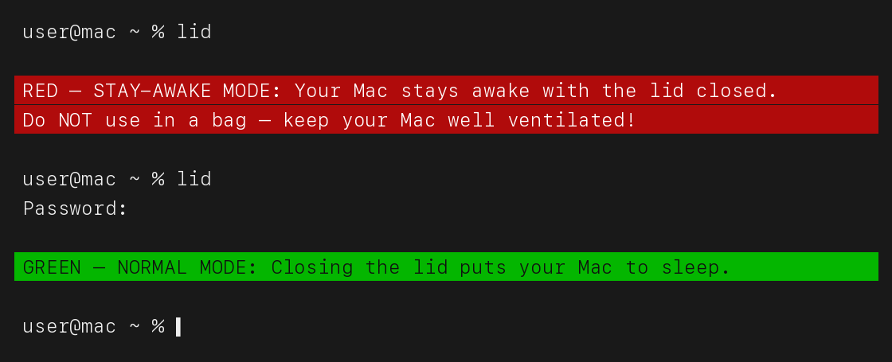

# macOS Lid

**Keep your MacBook awake with the lid closed, without leaving its built-in screen lit.**

Type `lid` in Terminal to toggle between normal sleep and stay-awake mode.
In stay-awake mode, closing the lid sets the built-in display brightness to 0%.
Opening it restores the previous brightness automatically. External displays are
left alone.

For example: start at 60% brightness → close the lid → 0% → open it → 60% again.
Switching back to normal mode restores the usual sleep behavior.



*English terminal example with a neutral prompt. Both modes are shown below.*

## Quick start

You need a MacBook running macOS, the default zsh shell, and Apple's Command Line
Tools (`xcode-select --install` if they are not already installed). The helper
uses a private macOS brightness API, so compatibility should be checked after
major macOS upgrades.

The `main` branch contains the complete version. The `before-brightness` tag
preserves the original sleep toggle without the brightness helper.

```sh
git clone https://github.com/eliaspfeffer/macos-lid.git
cd macos-lid
./install.sh
```

The installer builds and tests the brightness helper, signs it locally, and starts
it in the background. It starts automatically when you log in. Installation does
not change your shell configuration or enable stay-awake mode.

If you do not already have a `lid` command, load the included function:

```sh
source "$PWD/lid.zsh"
lid
```

To make the command available in future Terminal windows, add a `source` line to
`~/.zshrc` using the absolute path to your cloned `lid.zsh` file.

## Everyday use

Run `lid` once to enable stay-awake mode; run it again to return to normal sleep.
The command asks for your administrator password because it changes the system
sleep setting with `pmset`. Its English status messages use
red for stay-awake mode and green for normal mode.

Keep the Mac ventilated while it is awake with the lid closed. Turn stay-awake
mode off before putting it in a bag. Setting brightness to 0% dims the screen;
it does not put the Mac to sleep.

## Check that it works

```sh
~/.local/bin/lid-brightness --status
~/.local/bin/lid-brightness --self-test
```

For a real check, enable stay-awake mode with `lid`, note your brightness, then
close and reopen the lid. The original brightness should return. Run `lid` again
to return to normal mode.

## How it works

The shell function toggles macOS's `SleepDisabled` setting. A small Swift helper
checks that setting and the lid state every 250 ms. Before dimming the built-in
screen, it saves the last brightness observed while the lid was open. It restores
that value when the lid opens or normal sleep mode is restored.

The saved value survives helper restarts and is deleted only after restoration
is confirmed. If the helper first starts with the lid closed and no saved value,
it waits for the lid to open rather than guessing the previous brightness.

Installed files:

- Helper: `~/.local/bin/lid-brightness`
- Login service: `~/Library/LaunchAgents/com.eliaspfeffer.lid-brightness.plist`
- Saved brightness: `~/Library/Application Support/LidBrightness/brightness.json`
- Logs: `~/Library/Logs/lid-brightness.log`

The brightness API usage follows [nriley/brightness](https://github.com/nriley/brightness/blob/master/brightness.c).

## Uninstall

Open the lid and let the previous brightness return. If stay-awake mode is on,
run `lid` to turn it off, then remove the background helper:

```sh
launchctl bootout "gui/$(id -u)/com.eliaspfeffer.lid-brightness"
rm ~/Library/LaunchAgents/com.eliaspfeffer.lid-brightness.plist
rm ~/.local/bin/lid-brightness
```

If you added a `source` line to `~/.zshrc`, remove it to stop loading the `lid`
command in new Terminal windows. Removing the helper alone does not change the
system sleep setting.

## Compatibility and testing

Tested on the maintainer’s MacBook, including a real lid close/open cycle.
This is a small macOS utility, not an Apple-supported sleep feature. It uses
a private brightness API and is not guaranteed to work on every Mac or future
macOS release. The self-test covers restoration, restart recovery, zero brightness,
and write/persistence failures. It does not replace testing on your own hardware.

## License

MIT — see [LICENSE](LICENSE).
